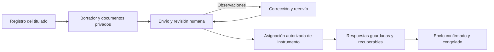

<div align="center">

# Grupo 18B · Selección de Personal

**Sistematización de Herramientas Métricas para la Selección de Personal**

Proyecto académico de Tecnología Web · Universidad Autónoma Gabriel René Moreno (UAGRM)


[Inicio local](#inicio-local) · [Recorrido](#recorrido) · [Instrumentos privados](#instrumentos-privados) · [Verificación](#verificacion) · [Documentación](#documentacion)

</div>

<p align="center">
  
</p>

<p align="center"><sub>Vista pública del segundo corte visual. No contiene expedientes ni material de evaluación.</sub></p>

> Piloto académico con sesión real, expedientes privados y revisión humana. No automatiza decisiones de admisión o selección ni constituye un servicio publicado. Los badges describen el stack: no representan un estado de CI ni una certificación institucional.

## ¿Qué resuelve?

| Para el titulado                                                            | Para el personal revisor                                                            | Instrumentos del piloto                                                                                                                                                                                          |
| --------------------------------------------------------------------------- | ----------------------------------------------------------------------------------- | ---------------------------------------------------------------------------------------------------------------------------------------------------------------------------------------------------------------- |
| Registro, borrador, documentos privados, envío, observaciones y corrección. | Bandeja, toma de revisión, revisión documental/académica/CV e historial versionado, y **perfil interno consolidado** del expediente. | Hábil: 15 ejercicios A–H con resultado bruto interno. Dominós: 48 ejercicios con captura de dos cifras y envío **sin calificación**. 16 FP A/B: 187 reactivos de texto cada forma, captura **sin calificación**. |

La cuenta y la persona se vinculan explícitamente. El registro público no concede capacidad de revisión; los permisos se validan en Laravel, no mediante un selector de actores. El catálogo UAGRM facilita la declaración de facultad/carrera, sin decidir admisión o equivalencias.

<a id="recorrido"></a>

## Del registro al envío



El titular trabaja en `/registro`, `/ingresar` y `/portal/inscripcion`. El personal utiliza `/personal/inscripciones` y, si tiene capacidad, el banco privado. Las rutas reales están separadas de las pantallas **DEMO — referencia de plantilla**; no introducir datos personales en las demos.

<a id="inicio-local"></a>

## Inicio local

### Requisitos

| Herramienta        | Referencia para esta instalación                                                                                                        |
| ------------------ | --------------------------------------------------------------------------------------------------------------------------------------- |
| PHP + Composer     | PHP 8.2 o superior y Composer 2; entorno probado con PHP 8.4.26. Habilitar las extensiones exigidas por Composer, incluido `pdo_pgsql`. |
| Node.js + Corepack | Entorno probado con Node 22. Usar Corepack dentro de `frontend/`.                                                                       |
| pnpm               | **9.15.4**, fijado en `frontend/package.json`. Conservar `pnpm-lock.yaml`.                                                              |
| PostgreSQL         | Servidor accesible y base local propia. Cliente 17.6 observado; no es una exigencia de versión del servidor.                            |
| Terminal           | Windows nativo y PowerShell 7 para los comandos y el lanzador documentados.                                                             |

Preparar privadamente la base de desarrollo `tecnoweb18b` y su rol con acceso. Si se van a ejecutar pruebas, preparar **otra base**, `tecnoweb18b_test`: es desechable y nunca debe contener información real. El repositorio no incluye bases, cuentas ni contraseñas. Guía ampliada: [preparación Windows](docs/06-preparacion-windows.md).

### 1. Preparar Laravel

Desde la raíz del repositorio:

```powershell
Set-Location backend
composer install
if (-not (Test-Path .env)) { Copy-Item .env.example .env }
```

Editar `backend/.env` **privadamente**: `DB_HOST`, `DB_PORT`, `DB_DATABASE`, `DB_USERNAME` y `DB_PASSWORD` deben corresponder a tu PostgreSQL local. Mantener `APP_DEBUG=false`. El ejemplo ya contempla el frontend `http://localhost:5173` y Sanctum SPA con cookies/CSRF. Nunca sobrescribir un `.env` existente ni compartirlo.

Después de completar la configuración, dentro de `backend/`:

```powershell
composer check-platform-reqs
# Sólo si está vacía: no rotar una APP_KEY existente.
if (Select-String -Path .env -Pattern '^APP_KEY=\s*$' -Quiet) { php artisan key:generate }
php artisan config:clear
php artisan migrate
php artisan catalog:import
```

`migrate` aplica únicamente migraciones pendientes; **no usar `migrate:fresh`, reset o fixtures sobre desarrollo**. El catálogo público de trabajo se importa idempotentemente desde `docs/data/catalogo-uagrm.json`. No se usa Inertia ni un starter visual Laravel: el backend es una API JSON independiente.

### 2. Instalar el frontend

En otra terminal, desde la raíz:

```powershell
Set-Location frontend
$env:HUSKY = '0'
corepack pnpm install --frozen-lockfile
```

El valor de Husky evita instalar hooks heredados de publicación de la plantilla. No usar el pnpm global de otra versión ni actualizar masivamente dependencias. Las variables `VITE_` son públicas: **nunca contienen claves, contraseñas ni material de instrumentos**.

### 3. Levantar ambos servicios

Con dependencias y base preparadas, desde la raíz:

```powershell
.\dev-local.ps1
.\dev-local.ps1 -Action Status
```

| Servicio                    | URL local                                                                    |
| --------------------------- | ---------------------------------------------------------------------------- |
| Aplicación React            | [http://localhost:5173](http://localhost:5173)                               |
| Estado React → API → base   | [http://localhost:5173/estado-tecnico](http://localhost:5173/estado-tecnico) |
| Salud de Laravel/PostgreSQL | [http://127.0.0.1:8001/api/health](http://127.0.0.1:8001/api/health)         |

El lanzador comprueba la base de desarrollo y arranca o reutiliza servicios sanos en **8001/5173**. No migra, importa, crea cuentas ni detiene procesos ajenos. Si un puerto tiene otro servicio, informa el bloqueo. Un chequeo de salud no acredita por sí solo permisos o un recorrido completo.

<details>
<summary>Alternativa: iniciar manualmente en dos terminales</summary>

Terminal A, desde la raíz:

```powershell
Set-Location backend
php artisan serve --no-reload --host=127.0.0.1 --port=8001
```

Terminal B, desde la raíz:

```powershell
Set-Location frontend
$env:API_PROXY_TARGET = 'http://127.0.0.1:8001'
corepack pnpm dev
```

Vite envía `/api` y `/sanctum` a Laravel; su destino por defecto en el código es `http://localhost:8001`. La variable anterior fija explícitamente IPv4 para esta alternativa. No se necesitan secretos en un `.env` de frontend. Reiniciar el servicio correspondiente al cambiar su configuración.

</details>

### 4. Usar cuentas propias

- **Titular:** crear su cuenta desde `/registro` y entrar por `/ingresar`. Completar la inscripción propia y enviarla; no convertir ni transferir un legado por coincidencia de nombre/correo.
- **Revisor nuevo:** dentro de `backend/`, ejecutar `php artisan pilot:account --reviewer`. Solicita nombre, correo único, contraseña oculta y confirmación explícita. No crea expedientes ni concede rol de titular o permisos de publicación.
- **Revisor existente:** conservar su cuenta y capacidades. Consultar `php artisan help talent:reviewer` si se necesita una modificación deliberada; no volver a crear usuarios para probar.

Una vez asignada la revisión del expediente: pestaña **Pruebas** → elegir versión → **Asignar prueba**. El titular responde desde `/portal/pruebas`, guarda, recarga y confirma el envío. El revisor consulta desde el expediente. Para Dominós, abrir **Consultar respuestas capturadas (sin calificación)** después del envío.

## Servicios empresariales · primer incremento B

Referencia funcional de este cierre: **`ee17c64c2e02baf0b615656944ac867e62d85cf4`**. Es el commit de código y pruebas; el sello documental de las ramas puede ser posterior. Repositorio privado: [Grupo 18B](https://github.com/marcelojp03/tecnoweb-18b-seleccion-personal). No es un despliegue.

La solicitud inicial no exige cuenta; la gestión continua sí exige sesión personal y una vinculación empresarial activa. La empresa no es una cuenta compartida y ser su responsable no concede revisión de talento ni administración global. Es una decisión técnica provisional de Marcelo para este corte, no una matriz de permisos aprobada por Administración.

| Actor | Ruta | Acceso |
| --- | --- | --- |
| Visitante | `/servicios/solicitud` | Solicitud S11-B y descripción S11-C → resumen → confirmación → folio y código |
| Visitante con folio y código | `/servicios/consulta` | Sólo resumen mínimo y estado; sin contacto, salario, candidatos, historial, documentos ni informes |
| Responsable vinculado | `/empresa/servicios` | Solicitudes de sus empresas activas; cargo, candidatos y edición versionada |
| Personal de servicios | `/personal/servicios` | Capacidad explícita `can_manage_services`, separada de `can_review_talent` |

Una solicitud pública nace sin empresa atribuida. La vinculación verificada corresponde al personal; no se hace por nombre, correo o dominio. Dos responsables activos de una empresa trabajan sobre las mismas solicitudes; desactivar la vinculación o la empresa retira el acceso en la siguiente petición, incluso con sesión abierta. El historial empresarial conserva acciones, versiones y fechas; los cambios históricos internos y la identidad del personal no se entregan por pertenecer a la empresa.

El código se muestra una sola vez y se guarda únicamente como hash; es reutilizable para consultar ese resumen, no para editar. Guardarlo privadamente: ni el folio solo ni la pertenencia empresarial publican datos. No se usa `localStorage` como persistencia funcional.

### Preparación administrativa deliberada (no ejecutada automáticamente)

La verificación funcional se realizó en `tecnoweb18b_test`. En el cierre autorizado se aplicaron a `tecnoweb18b` únicamente las cuatro migraciones incrementales de B: las seis tablas empresariales quedaron vacías y `can_manage_services` quedó en `false` para todas las cuentas. No se ejecutaron fixtures, fresh/reset, altas ni concesiones automáticas. La salud de Laravel/PostgreSQL, el proxy de React y el arranque público están comprobados; el recorrido autenticado con cuentas propias de desarrollo sigue pendiente hasta prepararlas deliberadamente.

Los comandos siguientes se ejecutan **privadamente en `backend/`, por el operador local autorizado**; no se ejecutaron sus altas durante este cierre. Sustituir los correos `.example`, nombres y UUID por datos verificados. Las contraseñas se piden ocultas, mínimo 12 caracteres, con repetición; nunca se pasan en argumentos, archivos o mensajes. No compartir una cuenta empresarial conjunta.

```powershell
# 1. Personal gestor NUEVO: usar, por ejemplo, gestor@plataforma.example en el prompt.
# Confirmar explícitamente la capacidad provisional B. No concede revisión A.
php artisan pilot:account --services-manager

# 2. Dos cuentas personales NUEVAS de responsables: ejecutar una vez por persona.
# Ejemplos para los prompts: rrhh1@empresa.example y rrhh2@empresa.example.
# Confirmar habilitación del piloto; sin --reviewer ni --services-manager.
php artisan pilot:account
php artisan pilot:account

# 3. Crear sólo la empresa; no crea cuentas ni vincula por nombre/correo/dominio.
php artisan pilot:company create --company='Empresa verificada' --legal-name='Razón social verificada' --contact-email=contacto@empresa.example --no-interaction

# 4. Copiar el UUID REAL que imprimió create; no usar literalmente el marcador.
$empresaId = 'REEMPLAZAR_POR_UUID_REAL'
php artisan pilot:company link --company=$empresaId --email=rrhh1@empresa.example --role=hr_manager --status=active --actor=gestor@plataforma.example --no-interaction
php artisan pilot:company link --company=$empresaId --email=rrhh2@empresa.example --role=hr_manager --status=active --actor=gestor@plataforma.example --no-interaction

# 5. Consulta local administrativa: salida privada con empresas y vínculos, no contraseñas.
php artisan help pilot:company
php artisan pilot:company list --no-interaction

# 6. Baja deliberada del vínculo de una persona; no borra su cuenta ni afecta a la otra.
php artisan pilot:company unlink --company=$empresaId --email=rrhh2@empresa.example --actor=gestor@plataforma.example --no-interaction
# Para reactivar el mismo vínculo, volver a ejecutar link con --status=active.
```

`pilot:account` sin flags crea una cuenta sin titularidad, revisión A ni capacidad gestora B; el acceso empresarial aparece sólo tras una vinculación activa. Si la persona ya tiene una cuenta válida y habilitada, no recrearla: usar su correo exacto en `link`. `--services-manager` crea únicamente una cuenta nueva con `can_manage_services`, sin administración global, revisión de talento ni pertenencia empresarial; exige confirmación adicional y no modifica cuentas existentes. `pilot:company create` crea la organización; `link` registra la pertenencia y `unlink` la desactiva en la siguiente petición, aun con sesión abierta. `--actor` conserva la cuenta que registra la operación local, no sustituye el control de acceso al servidor.

Una solicitud pública se vincula **por separado** desde `/personal/servicios/:id`, con el UUID de empresa verificado y la versión vigente; la acción exige capacidad gestora y deja historial. Vincular una persona no atribuye automáticamente solicitudes públicas. El registro público `/registro` sigue creando sólo titulares, no representantes empresariales. No se construyen invitaciones, gestión de miembros desde la interfaz, acceso de candidatos, evaluaciones B ni informes. Correspondencia fuente → campo y evidencia en el [contrato B](docs/compose/spec/proceso-b-solicitud-cargo-candidatos.md).

<a id="instrumentos-privados"></a>

## Banco privado: reproducir el incremento

Un clon **no incluye** imágenes, Word, claves o ZIP de instrumentos. Obtener los paquetes por un canal privado del responsable de materiales; sin ellos puede utilizarse inscripción/documentos, pero el banco no se carga. No fabricar faltantes ni sustituir ejercicios por otros parecidos.

Disposición esperada junto al repositorio:

```text
proyecto-grupo18b/
├── tecnoweb-18b-seleccion-personal/   # este repositorio
│   ├── frontend/                    # React + TypeScript + Ant Design + Vite
│   ├── backend/                     # Laravel + Sanctum + PostgreSQL
│   └── docs/                        # contratos y evidencia saneada
└── resources/                       # material privado, fuera de Git
    ├── grupo18b-es-usted-muy-habil-imagenes-respuestas/
    │   └── es-usted-muy-habil/
    ├── dominos-reconstrucciones-48-v0.3.0/
    └── fp16-formas-a-b-v1.0.0/
        ├── manifest.json
        └── formas/forma-a.json, forma-b.json
```

Aplicadas las migraciones, desde `backend/` y en la base destinada a tu instalación:

```powershell
php artisan habil:import "../../resources/grupo18b-es-usted-muy-habil-imagenes-respuestas/es-usted-muy-habil" --marcelo-reviewed
php artisan dominos:import "../../resources/dominos-reconstrucciones-48-v0.3.0" --reviewed
php artisan fp16:import "../../resources/fp16-formas-a-b-v1.0.0"
```

Los flags registran conformidad visual de trabajo **sólo cuando corresponde a la revisión recibida**; no aprueban un instrumento institucionalmente. El 16 FP no requiere flag: su conformidad es estructural y tampoco es institucional. Importaciones transaccionales e idempotentes por manifest, archivos originales conservados y recursos en `backend/storage/app/private/instruments`. Las imágenes requieren sesión/autorización; no crear enlaces públicos ni copiar paquetes a `frontend/public` o a documentación pública.

### Tres modalidades, sin mezclar sus reglas

| Instrumento                              | Captura                                                                                                             | Envío y consulta                                                                                                                                                            |
| ---------------------------------------- | ------------------------------------------------------------------------------------------------------------------- | --------------------------------------------------------------------------------------------------------------------------------------------------------------------------- |
| **¿Es usted muy hábil?**                 | 15 ejercicios, una opción A–H o ausencia.                                                                           | Un punto por acierto en Laravel; resultado bruto sólo para el revisor autorizado. El titular no recibe claves ni puntuación.                                                |
| **Dominós · fuente `dominos-0.3.0`**     | 48 recursos y pares literales conservados.                                                                          | Referencia privada no asignable; no se modifica para habilitarla.                                                                                                           |
| **Dominós · `dominos-0.3.0-capture-v1`** | Ficha vertical: superior = primera cifra literal del Word; inferior = segunda. Valores 0–6; `null` = sin responder. | Guardado/recuperación, parciales, confirmación de ausencias, envío congelado y consulta del revisor **sin calificación automática**. Ausencia de puntaje no significa cero. |
| **16 FP · formas A y B**                 | 187 reactivos de texto por forma, tres opciones a/b/c o ausencia.                                                   | Formas separadas; guardado/recuperación, ausencias, envío congelado y **«Respuestas capturadas; sin calificación»**. Claves y baremos no importados.                        |

Para crear el perfil de captura en una instalación nueva, utilizar el **ID fuente** que imprimió `dominos:import`:

```powershell
# Sustituir el marcador por el UUID real informado por la importación:
php artisan dominos:enable-capture ID_FUENTE
```

El comando crea una versión técnica nueva e inmutable; repetirlo devuelve el mismo perfil, incluso si ya se utilizó. Reutiliza recursos sin cambiar imágenes, claves ni orden de cifras. La decisión de interfaz y la conformidad visual se registran separadas: **no confirman la orientación física de fichas inclinadas ni una aprobación institucional**. No hay tiempos, baremos, IQ/CI, crédito parcial, penalizaciones o clasificación por carrera implementados para Dominós.

La instalación local de trabajo ya recibió migración/importación/perfil tras verificarlos. **Un clon nuevo no hereda esa base ni esos materiales:** debe prepararse explícitamente. Guía y evidencia vigente: [Dominós, sección S7](docs/compose/spec/dominos-banco-privado-dos-mitades.md#s7-ampliación-ficha-vertical-y-captura-sin-calificación); [contrato de Hábil](docs/compose/spec/evaluacion-es-usted-muy-habil.md).

<a id="verificacion"></a>

## Verificación

Último cierre de Dominós/Hábil, documentado el **12/11/2026**, y cierre funcional del **16 FP A/B** el **13/11/2026**:

| Comprobación                                 | Resultado observado                                                                                                                          |
| -------------------------------------------- | -------------------------------------------------------------------------------------------------------------------------------------------- |
| Backend conjunto                             | 47 casos del foco Dominós/Hábil/16 FP: **46 aprobados, 1 omitido** por permisos de symlink Windows; 1.527 aserciones.                        |
| 16 FP A/B (banco textual)                    | 10 pruebas, 154 aserciones: importación doble idempotente, 187 reactivos por forma, opciones a/b/c, sin claves.                              |
| Frontend conjunto                            | **34/34** en cuatro archivos (evaluaciones, Dominós, 16 FP y cliente de API).                                                                |
| TypeScript + Vite / lint focal / formato     | Aprobados sobre el código final; build con las advertencias preexistentes de dependencias y tamaño de chunk.                                 |
| Chrome aislado, 16 FP A y B                  | **7/7 comprobaciones**: 187 reactivos reales por forma, asignación idempotente, instrucciones, captura y guardado, recarga y recuperación, ausencias confirmadas, envío congelado, aislamiento entre cuentas y consulta del revisor sin calificación; escritorio 1365×950 y móvil 390×844. |
| Desarrollo (sin fixtures)                    | Migración incremental `add_unscored_letter_capture` aplicada e importación privada ejecutada dos veces con los mismos identificadores: 2 versiones, 374 reactivos, 0 claves, 0 asignaciones creadas. |

El recorrido del 16 FP se repitió en Chrome contra Laravel y PostgreSQL reales en `tecnoweb18b_test`, con cuentas sintéticas del arnés y el banco privado completo. Las siete capturas quedan en el directorio TEMP privado de esa ejecución y **no** vienen en el clon. La corrección psicométrica del instrumento sigue pendiente: lo verificado es la captura fiel y el congelamiento del envío, no una puntuación. La prueba manual en desarrollo con cuentas propias sigue pendiente para Dominós y para el 16 FP.

El **perfil interno consolidado (A05)** se verificó el 13/11/2026 con **22/22** comprobaciones en Chrome contra `tecnoweb18b_test`: datos y procedencia del catálogo, documentos vigentes frente a versiones anteriores descargables, revisiones vigentes y anteriores después de una corrección, perfil actualizado tras el reenvío, resultado bruto sólo de Hábil, Dominós y ambas formas del 16 FP sin puntuación, estados vacíos, y rechazo del titular y del anónimo tanto en la interfaz como en los endpoints internos (`403`/`404`/`401`). Suma **6 pruebas de componente** nuevas y la regresión de vecindad del portal, con `tsc`, ESLint, Prettier y build en 0. El personal sigue sin acceso a borradores del titular (`404`): es el alcance vigente y no se amplió el permiso.

Estos números describen una ejecución concreta, **no un badge de CI ni toda la suite de demos**. El [informe](docs/compose/spec/dominos-banco-privado-dos-mitades.md) distingue tandas, límites y comprobantes locales. La deuda global de lint/locale de la plantilla permanece documentada; no se presenta como resuelta.

### Verificación del primer incremento B · listo para revisión local

| Control | Resultado ejecutado |
| --- | --- |
| Backend B y regresión de autoservicio A | **58/58, 1.232 aserciones**, sobre `tecnoweb18b_test` |
| Alta local segura de cuentas | **7/7, 62 aserciones**, confirmación explícita y capacidad B separada de A |
| Frontend | **86/86** en siete archivos y **8/8** en el foco final de entradas |
| Chrome real, escritorio y móvil | **8 bloques** del recorrido completo y **11 comprobaciones** de inicio/registro; **32 capturas**, sin desborde global ni en componentes medidos |
| Formato, lint, tipos y build | Pint, Prettier, ESLint cero warnings, TypeScript y Vite aprobados; advertencias de dependencias/chunk y del entorno de tests conservadas en logs |

Se comprobaron dos responsables compartiendo solicitudes y candidatos, aislamiento de otra empresa por URL/API/identificadores, payloads manipulados, bajas con sesión abierta, permisos A/B separados, consulta pública mínima y vinculación autorizada con historial. La edición parcial conserva idiomas y beneficios omitidos; un no-op no genera una versión artificial.

Evidencia privada persistente: `C:/Users/marcelo/grupo18b-evidencia-privada/2026-11-13-proceso-b/`. Incluye corridas, intentos separados, huellas y manifiesto SHA-256; no viene en Git. El ZIP privado `grupo18b-b-capturas-aprobadas-privado-2026-11-13-v1.zip` contiene un índice HTML autónomo y las 32 capturas aprobadas funcionalmente: extracción, inventario, hashes y enlaces relativos comprobados. No contiene instrumentos ni credenciales de cuentas. El visor no entregó píxeles inspeccionables: no se afirma aprobación estética ni conformidad WCAG integral. La [receta del arnés B](docs/compose/spec/proceso-b-solicitud-cargo-candidatos.md#reproducir-sin-alterar-desarrollo) utiliza sólo pruebas. El cierre posterior autorizado aplica las migraciones B en desarrollo sin empresas, cuentas, vínculos, solicitudes ni capacidades concedidas; la activación técnica no acredita el recorrido autenticado con cuentas propias.

Para repetir sólo las pruebas afectadas, con `tecnoweb18b_test` preparada:

```powershell
# Desde backend/:
php vendor/bin/phpunit --filter 'Fp16|Dominos|Habil' --testdox

# En otra terminal, desde frontend/:
corepack pnpm exec vitest run src/pilot/evaluations.test.tsx src/pilot/evaluations-dominos.test.tsx src/pilot/evaluations-fp16.test.tsx src/pilot/evaluations-api.test.ts --testTimeout=60000 --pool=forks --poolOptions.forks.singleFork
corepack pnpm build
```

El recorrido del 16 FP en navegador se repite con el arnés aislado; escribe sólo en `tecnoweb18b_test`, en almacenamiento TEMP temporal y con guardas que verifican la base y la huella de desarrollo:

```powershell
# Desde la raíz, con el banco privado ya presente fuera de Git:
pwsh backend/tests/browser/fp16-runtime.ps1 -Action Start   -StatePath "$env:TEMP/fp16-runtime.json"
pwsh backend/tests/browser/fp16-runtime.ps1 -Action Prepare -StatePath "$env:TEMP/fp16-runtime.json"
pwsh backend/tests/browser/fp16-runtime.ps1 -Action Run     -StatePath "$env:TEMP/fp16-runtime.json"
pwsh backend/tests/browser/fp16-runtime.ps1 -Action Stop    -StatePath "$env:TEMP/fp16-runtime.json"
```

`Stop` compara la huella de la base de desarrollo antes y después y falla si cambió. `Start` rechaza puertos ocupados o archivos de estado existentes: una ejecución nueva necesita un `StatePath` nuevo.

PHPUnit fuerza PostgreSQL y `tecnoweb18b_test`; los guards rechazan desarrollo y comprueban la conexión real antes de limpiar datos. Las pruebas pueden reiniciar **sólo esa base de pruebas**. No ejecutar suites de base concurrentemente con el navegador de QA. No reemplazar la base de test por la de desarrollo.

## Privacidad y límites

- Sesión real Sanctum SPA con cookies/CSRF; caché de sesión aislada por cuenta. Las demos mantienen su autenticación ficticia separada.
- Documentos y medios privados, descargas autorizadas, historial/versionado, conflictos 409 y respuestas congeladas tras enviar.
- No incluir `.env`, credenciales, bases, uploads, claves de corrección, paquetes, builds o capturas privadas en Git. Los tests de este repositorio usan fixtures **sintéticos**, no el banco real.
- Revisión humana y capacidades técnicas provisionales: sin admisión automática, publicación de resultados, OCR/IA o correo real implementados. Responsabilidades, consentimiento y uso institucional siguen pendientes.
- La identidad visual UAGRM/Administración es una dirección técnica provisional; se preservan los recursos y atribuciones recibidos, sin afirmar un manual oficial o certificación WCAG integral.

<a id="documentacion"></a>

## Documentación

| Tema                                | Referencia                                                                                                                                                            |
| ----------------------------------- | --------------------------------------------------------------------------------------------------------------------------------------------------------------------- |
| Propósito, contexto y decisiones    | [Contexto](docs/01-contexto.md) · [Producto](PRODUCT.md) · [Diseño](DESIGN.md)                                                                                        |
| Arquitectura, rutas y servicios     | [Base técnica](docs/02-base-tecnica.md)                                                                                                                               |
| Preparación local                   | [Windows / PHP / PostgreSQL](docs/06-preparacion-windows.md)                                                                                                          |
| Inscripción, documentos y revisión  | [Contrato del proceso A](docs/compose/spec/inscripcion-talento-expediente-privado.md)                                                                                 |
| Evaluaciones                        | [Hábil](docs/compose/spec/evaluacion-es-usted-muy-habil.md) · [Dominós y captura vertical](docs/compose/spec/dominos-banco-privado-dos-mitades.md) · [16 FP A/B](docs/compose/spec/fp16-banco-textual-captura.md)                    |
| Perfil interno del expediente       | [A05 · perfil consolidado](docs/compose/spec/perfil-consolidado-titulado.md)                                                                                                                                                          |
| Interfaz pública y portal           | [Segundo corte Figma](docs/compose/spec/adaptacion-figma-segundo-corte.md) · [Capturas públicas](docs/verification-captures/adaptacion-figma-segundo-corte/README.md) |
| Verificación histórica e incidentes | [Evidencia y límites](docs/04-verificacion.md) · [Primer commit y preparación de instrumentos](docs/compose/spec/primer-commit-y-preparacion-instrumento.md)          |
| Fuentes de requisitos               | [Índice Notion](docs/05-fuentes-notion.md)                                                                                                                            |

Los informes conservan su contexto temporal: un “sin commit” histórico describe aquella entrega, no una prohibición posterior a una autorización explícita. Los logs, capturas privadas y archivos de TEMP citados como evidencia local **no vienen en el clon**.

## Licencias y atribuciones

Frontend basado en [design-sparx/antd-multipurpose-dashboard](https://github.com/design-sparx/antd-multipurpose-dashboard), plantilla **2.0.2**, MIT, copyright © 2023 Kelvin Kiprop. Se conservan [frontend/LICENSE](frontend/LICENSE) y [frontend/README.md](frontend/README.md).

Backend basado en [laravel/laravel v12.0.0](https://github.com/laravel/laravel/tree/v12.0.0), licencia MIT en [backend/LICENSE](backend/LICENSE). Las fuentes externas de ambas plantillas permanecen intactas. Los materiales de evaluación se obtienen y custodian por separado; la licencia del código no implica permiso de publicación de esos materiales.
