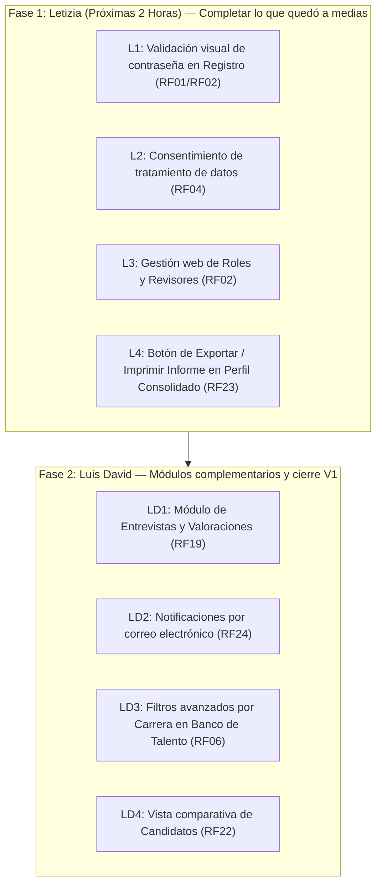

# Plan de Implementación — Primera Versión Estable y Funcional (V1)
**Proyecto Académico Grupo 18B — Sistematización de Herramientas Métricas para Selección de Personal**  
**Universidad Autónoma Gabriel René Moreno (UAGRM)**

---

## 🎯 Objetivo de la Entrega V1

Entregar una versión completa, estable y presentable que cubra el ciclo de vida completo de la selección de personal para el docente:
1. **Postulante:** Registro con validación clara, llenado de perfil profesional con catálogo UAGRM, consentimiento de datos, subida de CV/documentos y resolución de pruebas asignadas en `/portal/pruebas`.
2. **Evaluador / Revisor:** Gestión de roles desde interfaz web, revisión de expedientes, observaciones/correcciones, asignación y consulta de pruebas psicométricas (*¿Es usted muy hábil?* ya importada), registro de entrevistas, filtros por carrera y generación de informe individual para impresión/PDF.
3. **Notificaciones / Comunicación:** Avisos por correo (vía SMTP o simulador visible) en hitos críticos.

---

## 👥 División de Tareas



---

## 👩‍💻 Fase 1: Letizia (Próximas 2 Horas)
*Foco: Resolver los puntos que quedaron a medias o causan fricción en la experiencia de usuario y presentación.*

### Tarea L1: Validación visual de contraseña y errores en Registro (RF01 / RF02)
* **Problema detectado:** El formulario de `/registro` en el frontend solo exigía campo obligatorio, pero el backend exige estrictamente `min:12`. Además, al ocurrir un error 422 el bloque `finally` reseteaba los campos de contraseña, borrando el mensaje de error de la pantalla.
* **Archivos a modificar:** `frontend/src/pilot/public.tsx`.
* **Paso a paso:**
  1. En `public.tsx`, dentro del `Form.Item` con `name="password"`, añadir la regla de longitud mínima:
     ```tsx
     rules={[
       { required: true, message: 'Ingresá una contraseña.' },
       { min: 12, message: 'La contraseña debe tener al menos 12 caracteres.' }
     ]}
     ```
  2. En el método `submit` de `RegisterPage`, en el bloque `catch`, asegurar que el mensaje de error del backend (campo `password`) se muestre en el componente `<Alert>` o bajo el input, evitando que `resetFields` lo borre antes de que el usuario lo lea.
* **Verificación:** Probar escribir una contraseña de 8 letras en `/registro` y ver que el formulario avisa inmediatamente antes de enviar.

---

### Tarea L2: Casilla de Consentimiento de Datos Personales (RF04)
* **Objetivo:** Cumplir formalmente con el requerimiento de consentimiento del postulante.
* **Archivos a modificar:**
  - `frontend/src/pilot/draft.tsx` (pantalla de `/portal/inscripcion`).
  - `backend/app/Http/Controllers/TalentWorkflowController.php` (o controlador de envío de inscripción).
* **Paso a paso:**
  1. **Frontend:** Antes del botón **"Enviar inscripción"** en `/portal/inscripcion`, agregar un componente `Checkbox` obligatorio:
     ```tsx
     <Form.Item
       name="consent_accepted"
       valuePropName="checked"
       rules={[
         {
           validator: (_, value) =>
             value ? Promise.resolve() : Promise.reject(new Error('Debes aceptar el consentimiento de datos para postular.')),
         },
       ]}
     >
       <Checkbox>
         Declaro que la información proporcionada es verídica y otorgo mi consentimiento a la UAGRM para el tratamiento de mis datos y expediente en este proceso de selección.
       </Checkbox>
     </Form.Item>
     ```
  2. **Backend:** En el método de envío (`/enviar`), validar que el consentimiento venga aceptado y guardar la marca de tiempo `consent_accepted_at = now()`.

---

### Tarea L3: Panel Web de Gestión de Roles de Personal (RF02)
* **Objetivo:** No depender de la terminal (`php artisan pilot:account --reviewer`) para otorgar permisos a otros compañeros o al docente.
* **Archivos a modificar:**
  - `backend/app/Http/Controllers/UserRoleController.php` (nuevo o dentro de `AuthController`).
  - `backend/routes/api.php`.
  - `frontend/src/pilot/users-management.tsx` (nueva vista).
  - `frontend/src/routes/routes.tsx`.
* **Paso a paso:**
  1. Crear un endpoint `GET /api/personal/usuarios` protegido por `can_review_talent` que liste los usuarios registrados: `id`, `name`, `email`, `can_review_talent`, `can_manage_services`.
  2. Crear un endpoint `POST /api/personal/usuarios/{id}/toggle-reviewer` para alternar la capacidad `can_review_talent`.
  3. En el frontend, agregar una pestaña o enlace en el menú del personal (`/personal/usuarios`) con una tabla sencilla de Ant Design con columnas: Nombre, Correo, Rol Revisor (Switch On/Off) para activar/desactivar permisos en un clic.

---

### Tarea L4: Exportación / Impresión del Perfil Consolidado (RF23)
* **Objetivo:** Generar el informe individual de selección para el candidato evaluado.
* **Archivos a modificar:** `frontend/src/pilot/profile-consolidated.tsx`.
* **Paso a paso:**
  1. En la parte superior de `/personal/inscripciones/:id/perfil`, agregar un botón:
     ```tsx
     <Button type="primary" icon={<PrinterOutlined />} onClick={() => window.print()}>
       Imprimir Informe / Guardar PDF
     </Button>
     ```
  2. Añadir estilos CSS de impresión con `@media print`:
     - Ocultar la barra lateral (sidebar), cabeceras de navegación y botones de acción.
     - Mostrar un encabezado formal arriba: *"Universidad Autónoma Gabriel René Moreno — Informe de Evaluación de Postulante"*.
     - Asegurar que los datos del estudiante, notas de la prueba *¿Es usted muy hábil?* y conclusiones de revisión se impriman en hojas limpias.

---

## 👨‍💻 Fase 2: Luis David (Consolidación Funcional de la V1)
*Foco: Módulos de proceso de selección que completan los casos de uso restantes.*

### Tarea LD1: Módulo de Entrevistas y Valoraciones (RF19)
* **Objetivo:** Permitir agendar y registrar entrevistas presenciales/virtuales con el postulante evaluado.
* **Paso a paso:**
  1. **Migración en Laravel:** Crear tabla `interviews`:
     - `id` (uuid), `talent_registration_id` (foreign key), `scheduled_at` (datetime), `modality` (`presencial` o `virtual`), `interviewer_name` (string), `notes` (text), `rating` (integer 1-5 o string: `favorable`/`desfavorable`), `conclusions` (text), `timestamps`.
  2. **Controlador:** `InterviewController` con métodos `index($registrationId)` y `store($request, $registrationId)`.
  3. **Frontend:** En la vista del expediente del personal (`/personal/inscripciones/:id`), añadir una pestaña **"Entrevistas"**:
     - Formulario modal: Fecha/Hora, Modalidad, Calificación y Conclusión.
     - Lista/Timeline de entrevistas realizadas al postulante con su dictamen.

---

### Tarea LD2: Notificaciones por Correo Electrónico (RF24)
* **Objetivo:** Notificar por email ante hitos del proceso.
* **Paso a paso:**
  1. En `backend/.env`, configurar un servidor SMTP real (puede ser Mailtrap para pruebas seguras o una cuenta Gmail con App Password):
     ```env
     MAIL_MAILER=smtp
     MAIL_HOST=sandbox.smtp.mailtrap.io
     MAIL_PORT=2525
     MAIL_USERNAME=tu_usuario
     MAIL_PASSWORD=tu_password
     MAIL_FROM_ADDRESS=seleccion@uagrm.edu.bo
     MAIL_FROM_NAME="Selección de Personal UAGRM"
     ```
  2. Crear clase Mailable en Laravel:
     `php artisan make:mail EvaluationAssignedMail`
  3. En `EvaluationController@assign`, cuando el revisor asigne una prueba, disparar el correo al titular:
     ```php
     Mail::to($record->holder->email)->queue(new EvaluationAssignedMail($instrument->name));
     ```
  4. Crear plantilla de correo con diseño institucional avisando: *"Tienes una nueva prueba psicométrica asignada en el portal: [Nombre Prueba]"*.

---

### Tarea LD3: Filtros Avanzados en Bandeja de Talento (RF06)
* **Objetivo:** Buscar y segmentar candidatos en el banco de talentos.
* **Paso a paso:**
  1. En `TalentReviewController@index`, agregar filtros por parámetros query:
     - `career`: filtrar postulantes por carrera declarada.
     - `faculty`: filtrar por facultad.
     - `has_evaluations`: booleano para ver solo quienes ya rindieron pruebas.
  2. En el frontend (`/personal/inscripciones`), agregar una barra de filtros con selectores de Ant Design (`Select` de Carreras alimentado por `/api/catalogo-uagrm`).

---

### Tarea LD4: Matriz Comparativa Básica de Candidatos (RF22)
* **Objetivo:** Permitir al revisor seleccionar varios candidatos y ver una comparativa en tabla lado a lado.
* **Paso a paso:**
  1. En la tabla de `/personal/inscripciones`, habilitar selección múltiple con checkboxes (`rowSelection` en Ant Design Table).
  2. Al seleccionar 2 o más candidatos, habilitar el botón **"Comparar seleccionados"**.
  3. Mostrar un Drawer o pantalla comparativa con una tabla de columnas por candidato:
     - Nombre completo y Contacto.
     - Carrera y Facultad.
     - PPA declarado.
     - Resultado en prueba psicométrica (*¿Es usted muy hábil?*).
     - Estado de revisión documental.

---

## ⏱️ Cronograma de Ejecución Sugerido

| Horario | Responsable | Tarea | Entregable |
| :--- | :---: | :--- | :--- |
| **06:00 – 06:20** | **Letizia** | **L1:** Reglas y feedback de contraseña en `/registro` | Formulario valida $\ge 12$ caracteres visualmente |
| **06:20 – 06:50** | **Letizia** | **L2:** Consentimiento de datos en `/portal/inscripcion` | Checkbox obligatorio y timestamp en BD |
| **06:50 – 07:35** | **Letizia** | **L3:** Gestión web de roles en `/personal/usuarios` | Switch para hacer revisor a cualquier usuario sin consola |
| **07:35 – 08:00** | **Letizia** | **L4:** Botón de impresión limpia en `/perfil` | Reporte imprimible/PDF con membrete UAGRM |
| **08:00 – 08:50** | **Luis David** | **LD1:** Módulo de entrevistas en expediente | Pestaña de entrevistas y registro de conclusiones |
| **08:50 – 09:30** | **Luis David** | **LD2:** Notificaciones por email al asignar pruebas | Correo SMTP automático al postulante |
| **09:30 – 10:10** | **Luis David** | **LD3:** Filtros por carrera en banco de talento | Filtrado dinámico con catálogo UAGRM |
| **10:10 – 10:50** | **Luis David** | **LD4:** Comparador de candidatos en bandeja | Vista comparativa de 2+ postulantes seleccionados |
